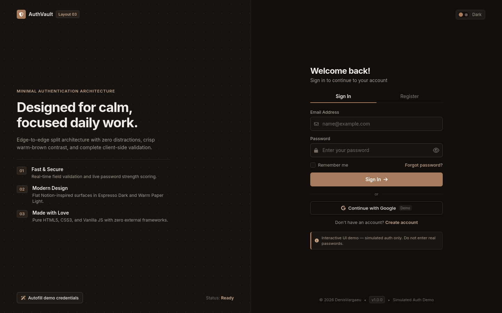
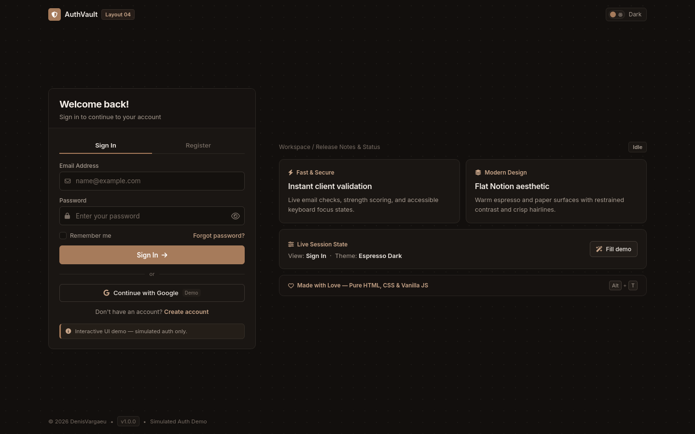
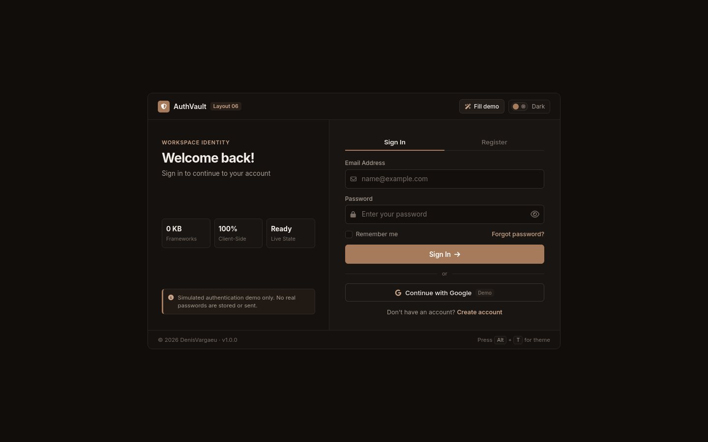
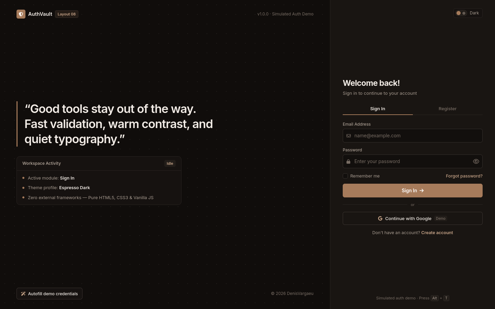

# AuthVault — Modern Login System (Demo)

A collection of **8 flat, Notion-inspired authentication UI layouts** built with pure **HTML5, CSS3, and Vanilla JavaScript** — zero frameworks, warm espresso & paper color palettes, zero emojis, full Dark/Light theme support, and simulated client-side authentication.

> **Demo Notice:** This project uses simulated authentication only. No real passwords or credentials are collected, transmitted, or stored.

---

## Layouts Preview

### Layout 1 — Right Editorial Split (`/1`)
Interactive Notion-style Workspace Canvas with a subtle animated vector line, Live Session Inspector, and a right-aligned authentication card.


---

### Layout 2 — Centered Minimal Notion Document (`/2`)
Distraction-free single-column centered Notion document with a subtle top accent bar and a minimal command strip below the card.


---

### Layout 3 — Full-Height 50/50 Split Screen (`/3`)
Edge-to-edge full-viewport split architecture with an editorial numbered overview (`01 / 02 / 03`) on the left and a clean form canvas on the right.



---

### Layout 4 — Left Card + Right Workspace Board (`/4`)
Reversed asymmetric composition with the authentication card anchored on the left and a modular Notion Workspace Board on the right.



---

### Layout 5 — Notion Sidebar App Shell (`/5`)
Full Notion-style workspace window featuring a persistent left navigation sidebar (view links, quick tools, live session metadata) paired with a centered document form.


---

### Layout 6 — Framed Editorial Horizontal Card (`/6`)
Centered framed application window with a top action bar, a left manifesto + live metrics column, and a right authentication panel.



---

### Layout 7 — Command Modal / Spotlight Style (`/7`)
Compact keyboard-first command modal (`authvault://access`) over a subtle architectural grid, featuring side-by-side Sign In / Google actions and a shortcut footer bar.


---

### Layout 8 — Asymmetric 65/35 Split with Right Drawer (`/8`)
Wide editorial canvas with a Notion-style blockquote and live activity timeline on the left, paired with a full-height docked authentication drawer on the right.



---

## Features

- **Login & Registration Views** with smooth underline tab transitions.
- **Real-Time Validation** for names, email format, password rules, and confirmation matching.
- **4-Level Password Strength Indicator** with live requirements checklist (8+ chars, uppercase, number, symbol).
- **Password Visibility Toggles** on all password inputs.
- **Forgot Password Demo Screen** with simulated recovery confirmation.
- **Remember Me** (remembers demo email only — never stores passwords).
- **Dark / Light Theme Toggle** (`Espresso Dark` and `Warm Paper Light`) with `localStorage` persistence and `Alt + T` keyboard shortcut.
- **One-Click Demo Autofill** (`Fill demo credentials`) for quick testing.
- **Accessible Toast Notifications**, loading button states, semantic HTML, and responsive desktop/tablet/mobile layouts.

## Project Structure

```text
login/
├── index.html          # Default layout (Layout 1)
├── style.css
├── script.js
├── 1/                  # Layout 1: Right Editorial Split
├── 2/                  # Layout 2: Centered Minimal Notion Document
├── 3/                  # Layout 3: Full-Height 50/50 Split Screen
├── 4/                  # Layout 4: Left Card + Right Workspace Board
├── 5/                  # Layout 5: Notion Sidebar App Shell
├── 6/                  # Layout 6: Framed Editorial Horizontal Card
├── 7/                  # Layout 7: Command Modal (Spotlight Style)
├── 8/                  # Layout 8: Asymmetric 65/35 Split with Right Drawer
├── screenshots/        # Rendered desktop previews (1440x900)
└── README.md
```

## Quick Start

Open any `index.html` directly in your browser, or run a local static server:

```bash
python3 -m http.server 8000
```

Then visit `http://localhost:8000/1/` through `http://localhost:8000/8/`.

---

`v1.0.0` &bull; &copy; 2026 DenisVargaeu
