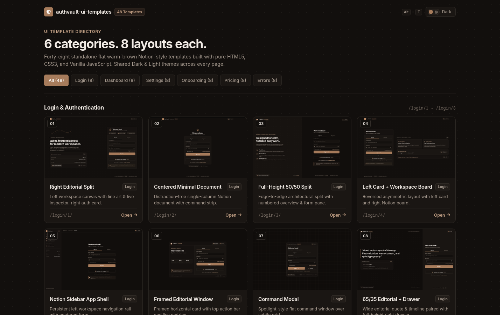
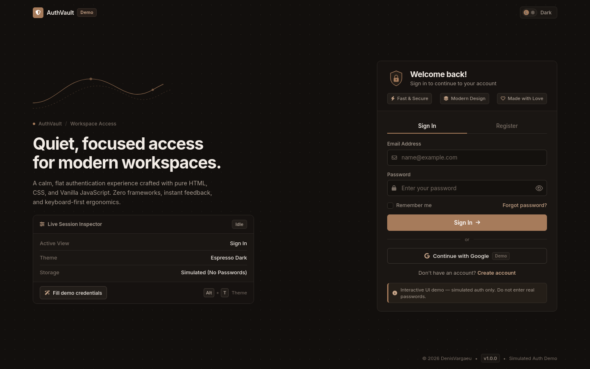
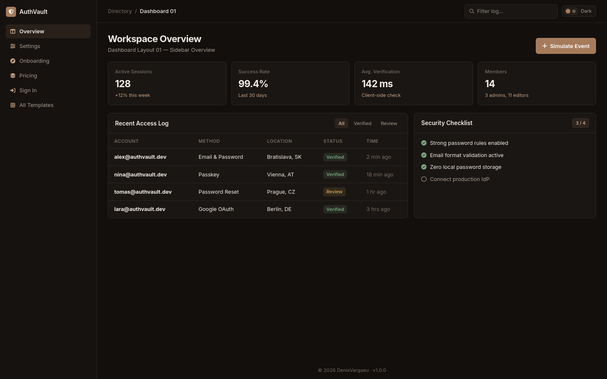
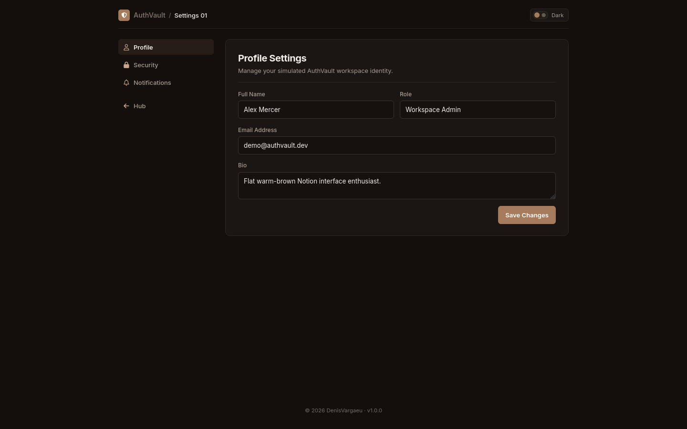
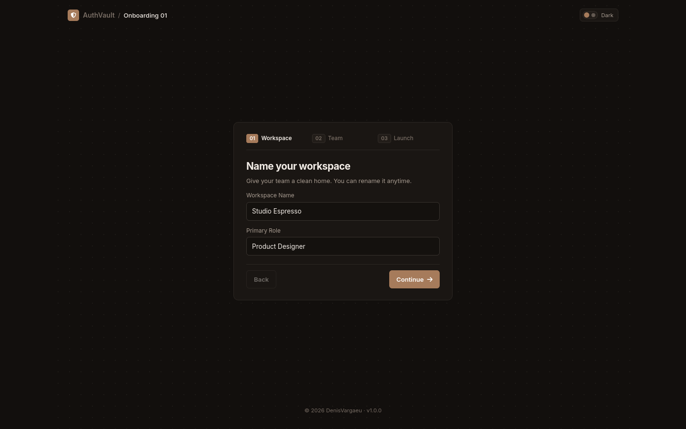
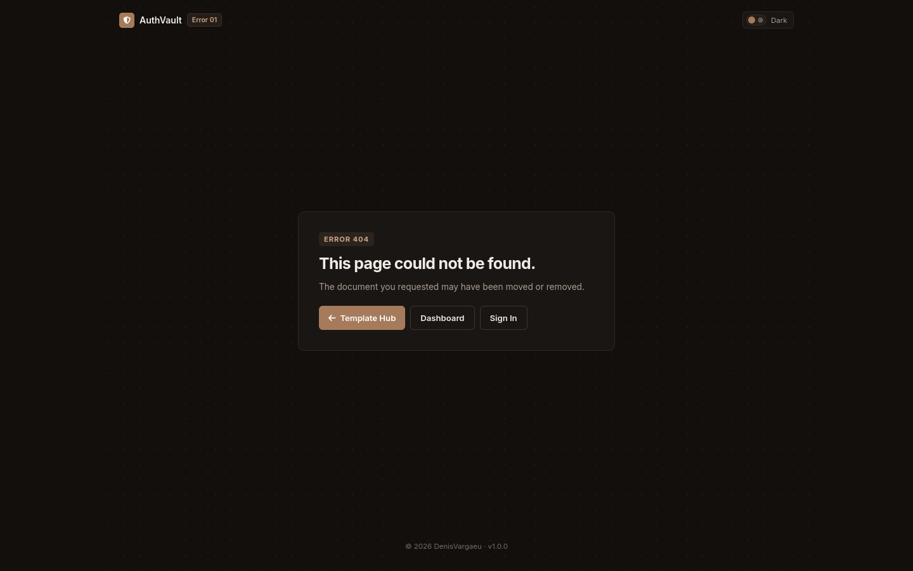

# authvault-ui-templates

An organized collection of **48 flat, Notion-inspired UI templates** (**6 categories &times; 8 distinct layouts each**) built with pure **HTML5, CSS3, and Vanilla JavaScript** — zero frameworks, warm espresso & paper color palettes, zero emojis, shared Dark/Light theme persistence (`Alt + T`), and simulated client-side interactions.

> **Demo Notice:** All forms and actions are simulated client-side only. No real passwords or credentials are collected, transmitted, or stored.

---

## Directory Hub (`/`)
Interactive template hub organizing all 48 pages with instant category filters (`All`, `Login`, `Dashboard`, `Settings`, `Onboarding`, `Pricing`, `Errors`) and shared Dark/Light theme switching.



---

## 1. Login & Authentication (`/login/1` – `/login/8`)



| # | Layout | Path | Screenshot |
|---|---|---|---|
| 01 | Right Editorial Split | `/login/1/` | [layout-1.png](./screenshots/layout-1.png) |
| 02 | Centered Minimal Document | `/login/2/` | [layout-2.png](./screenshots/layout-2.png) |
| 03 | Full-Height 50/50 Split | `/login/3/` | [layout-3.png](./screenshots/layout-3.png) |
| 04 | Left Card + Workspace Board | `/login/4/` | [layout-4.png](./screenshots/layout-4.png) |
| 05 | Notion Sidebar App Shell | `/login/5/` | [layout-5.png](./screenshots/layout-5.png) |
| 06 | Framed Editorial Window | `/login/6/` | [layout-6.png](./screenshots/layout-6.png) |
| 07 | Command Modal | `/login/7/` | [layout-7.png](./screenshots/layout-7.png) |
| 08 | 65/35 Editorial + Drawer | `/login/8/` | [layout-8.png](./screenshots/layout-8.png) |

---

## 2. Workspace Dashboards (`/dashboard/1` – `/dashboard/8`)



| # | Layout | Path | Screenshot |
|---|---|---|---|
| 01 | Sidebar Overview | `/dashboard/1/` | [dashboard-1.png](./screenshots/dashboard-1.png) |
| 02 | Top-Nav Centered | `/dashboard/2/` | [dashboard-2.png](./screenshots/dashboard-2.png) |
| 03 | Right Sidebar Rail | `/dashboard/3/` | [dashboard-3.png](./screenshots/dashboard-3.png) |
| 04 | Kanban Status Board | `/dashboard/4/` | [dashboard-4.png](./screenshots/dashboard-4.png) |
| 05 | KPI Rail + Activity Stream | `/dashboard/5/` | [dashboard-5.png](./screenshots/dashboard-5.png) |
| 06 | Framed Workspace Window | `/dashboard/6/` | [dashboard-6.png](./screenshots/dashboard-6.png) |
| 07 | Command Search Dashboard | `/dashboard/7/` | [dashboard-7.png](./screenshots/dashboard-7.png) |
| 08 | 65/35 Executive + Drawer | `/dashboard/8/` | [dashboard-8.png](./screenshots/dashboard-8.png) |

---

## 3. Account & Workspace Settings (`/settings/1` – `/settings/8`)



| # | Layout | Path | Screenshot |
|---|---|---|---|
| 01 | Left Nav Rail + Card | `/settings/1/` | [settings-1.png](./screenshots/settings-1.png) |
| 02 | Top Underline Tabs | `/settings/2/` | [settings-2.png](./screenshots/settings-2.png) |
| 03 | 50/50 Split Settings | `/settings/3/` | [settings-3.png](./screenshots/settings-3.png) |
| 04 | Right Nav Rail | `/settings/4/` | [settings-4.png](./screenshots/settings-4.png) |
| 05 | Sidebar App Shell | `/settings/5/` | [settings-5.png](./screenshots/settings-5.png) |
| 06 | Framed Window | `/settings/6/` | [settings-6.png](./screenshots/settings-6.png) |
| 07 | Command Modal | `/settings/7/` | [settings-7.png](./screenshots/settings-7.png) |
| 08 | Stacked Property Cards | `/settings/8/` | [settings-8.png](./screenshots/settings-8.png) |

---

## 4. Onboarding Wizards (`/onboarding/1` – `/onboarding/8`)



| # | Layout | Path | Screenshot |
|---|---|---|---|
| 01 | Centered Stepper Card | `/onboarding/1/` | [onboarding-1.png](./screenshots/onboarding-1.png) |
| 02 | Right Editorial Split | `/onboarding/2/` | [onboarding-2.png](./screenshots/onboarding-2.png) |
| 03 | 50/50 Vertical Stepper | `/onboarding/3/` | [onboarding-3.png](./screenshots/onboarding-3.png) |
| 04 | Left Wizard + Live Preview | `/onboarding/4/` | [onboarding-4.png](./screenshots/onboarding-4.png) |
| 05 | Sidebar App Shell | `/onboarding/5/` | [onboarding-5.png](./screenshots/onboarding-5.png) |
| 06 | Framed Setup Window | `/onboarding/6/` | [onboarding-6.png](./screenshots/onboarding-6.png) |
| 07 | Spotlight Command Setup | `/onboarding/7/` | [onboarding-7.png](./screenshots/onboarding-7.png) |
| 08 | 65/35 Quote + Drawer | `/onboarding/8/` | [onboarding-8.png](./screenshots/onboarding-8.png) |

---

## 5. Plans & Pricing (`/pricing/1` – `/pricing/8`)


| # | Layout | Path | Screenshot |
|---|---|---|---|
| 01 | 3-Column Classic Grid | `/pricing/1/` | [pricing-1.png](./screenshots/pricing-1.png) |
| 02 | Horizontal Stacked Tiers | `/pricing/2/` | [pricing-2.png](./screenshots/pricing-2.png) |
| 03 | 50/50 Split Pricing | `/pricing/3/` | [pricing-3.png](./screenshots/pricing-3.png) |
| 04 | Comparison Matrix Table | `/pricing/4/` | [pricing-4.png](./screenshots/pricing-4.png) |
| 05 | Sidebar Shell Pricing | `/pricing/5/` | [pricing-5.png](./screenshots/pricing-5.png) |
| 06 | Framed Pricing Window | `/pricing/6/` | [pricing-6.png](./screenshots/pricing-6.png) |
| 07 | Two-Tier Focus | `/pricing/7/` | [pricing-7.png](./screenshots/pricing-7.png) |
| 08 | 65/35 + Summary Drawer | `/pricing/8/` | [pricing-8.png](./screenshots/pricing-8.png) |

---

## 6. Errors & System Status (`/errors/1` – `/errors/8`)



| # | Layout | Path | Screenshot |
|---|---|---|---|
| 01 | Minimal Centered 404 | `/errors/1/` | [errors-1.png](./screenshots/errors-1.png) |
| 02 | Right Editorial 404 | `/errors/2/` | [errors-2.png](./screenshots/errors-2.png) |
| 03 | 50/50 Split 403 Forbidden | `/errors/3/` | [errors-3.png](./screenshots/errors-3.png) |
| 04 | 500 + Status Checklist | `/errors/4/` | [errors-4.png](./screenshots/errors-4.png) |
| 05 | Sidebar Shell 404 | `/errors/5/` | [errors-5.png](./screenshots/errors-5.png) |
| 06 | Framed Diagnostic Window | `/errors/6/` | [errors-6.png](./screenshots/errors-6.png) |
| 07 | Spotlight Quick-Recovery | `/errors/7/` | [errors-7.png](./screenshots/errors-7.png) |
| 08 | 65/35 Maintenance Mode (503) | `/errors/8/` | [errors-8.png](./screenshots/errors-8.png) |

---

## Project Structure

```text
authvault-ui-templates/
├── index.html              # Organized UI Template Directory Hub (48 templates)
├── style.css
├── script.js
├── login/1..8/             # 8 Authentication & Login layouts
├── dashboard/1..8/         # 8 Workspace Dashboard layouts
├── settings/1..8/          # 8 Account & Workspace Settings layouts
├── onboarding/1..8/        # 8 Onboarding Wizard layouts
├── pricing/1..8/           # 8 Plans & Pricing layouts
├── errors/1..8/            # 8 Error & System Status layouts
├── screenshots/            # 49 rendered desktop previews (1440x900)
└── README.md
```

## Quick Start

```bash
python3 -m http.server 8000
```

Open `http://localhost:8000/` to browse all 48 templates from the directory hub.

---

`v1.0.0` &bull; &copy; 2026 DenisVargaeu
