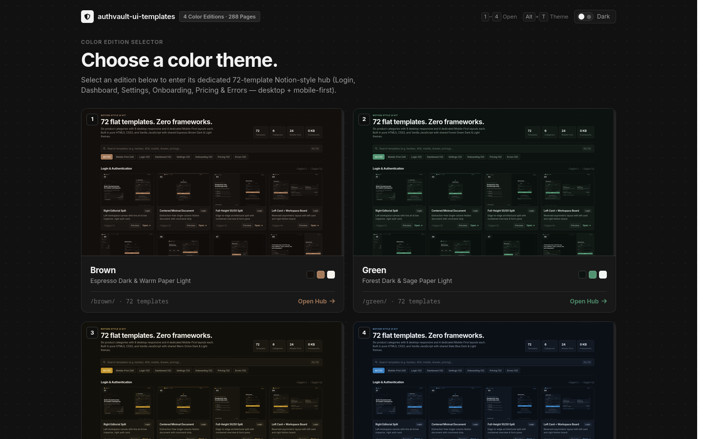
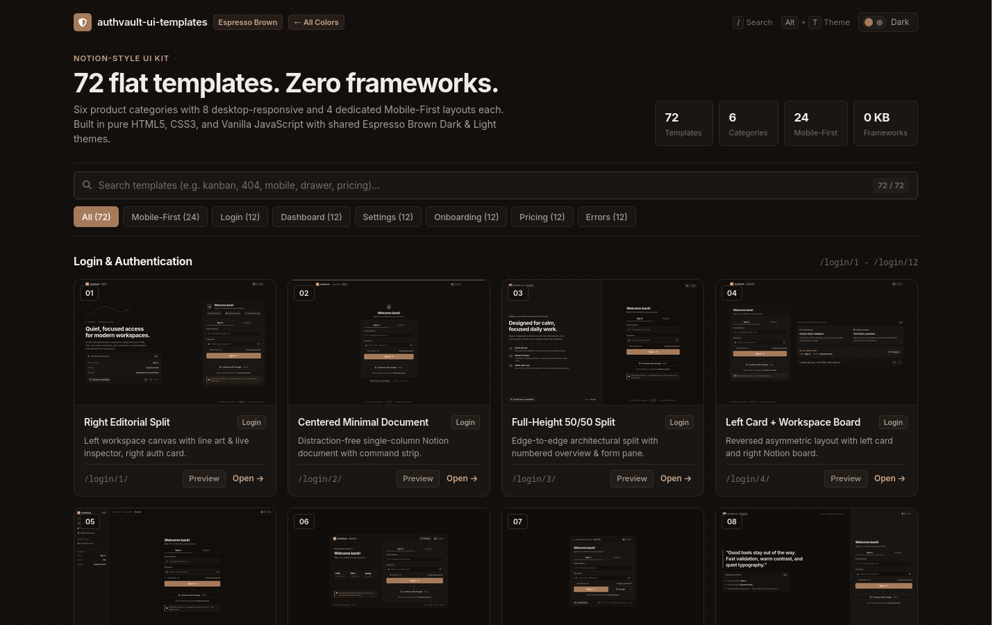
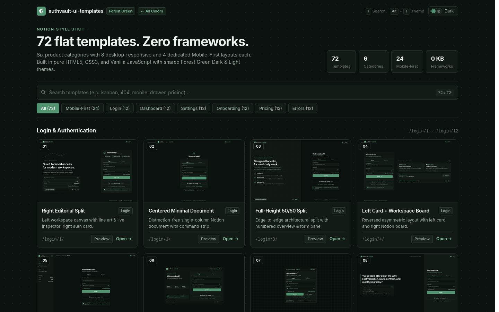
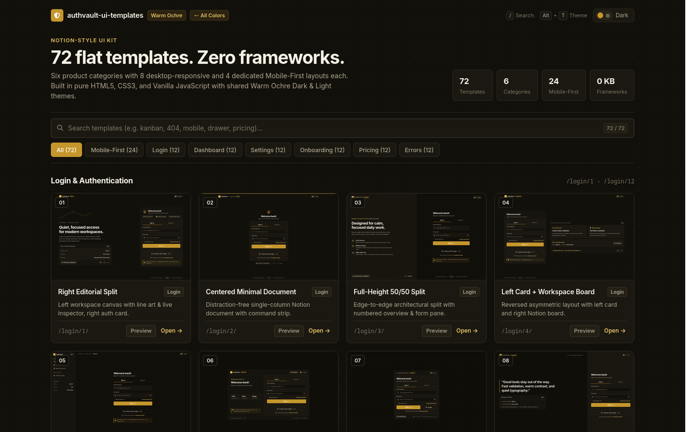
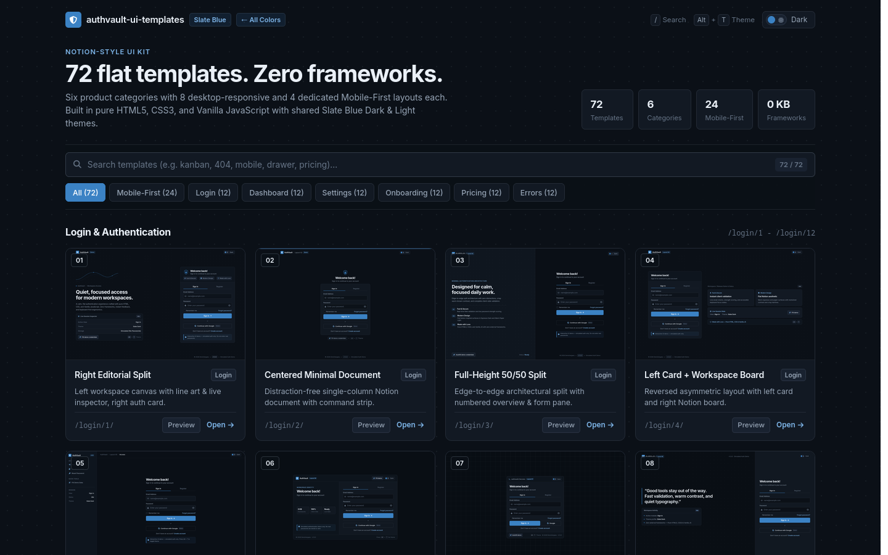

<div align="center">

# authvault-ui-templates

**4 Color Editions &times; 72 flat, Notion-inspired UI templates (288 pages total) — built with pure HTML5, CSS3, and Vanilla JavaScript.**

[](#color-editions)
[-a67b5b?style=flat-square&labelColor=181818)](#category-overview)
[](#category-overview)
[](#quick-start)
[](#project-structure)

[Color Selector](#color-editions) &middot; [Category Overview](#category-overview) &middot; [Quick Start](#quick-start) &middot; [Project Structure](#project-structure)

<br />



</div>

---

> [!NOTE]
> **Simulated Demo Only:** All authentication flows, settings forms, onboarding steps, and dashboard telemetry are simulated strictly on the client side. No real passwords or credentials are ever collected, transmitted, or stored.

## Color Editions

Open the root [index.html](./index.html) to pick a color theme (or press `1`–`4` on your keyboard) and jump straight into that edition's 72-template interactive hub. Every edition supports both **Dark** and **Light** modes (`Alt + T`).

<table>
  <tr>
    <td width="50%">
      
      <br /><strong>1 &mdash; Brown (Espresso &amp; Warm Paper)</strong> &middot; <code>/brown/</code>
    </td>
    <td width="50%">
      
      <br /><strong>2 &mdash; Green (Forest &amp; Sage Paper)</strong> &middot; <code>/green/</code>
    </td>
  </tr>
  <tr>
    <td width="50%">
      
      <br /><strong>3 &mdash; Yellow (Ochre &amp; Parchment)</strong> &middot; <code>/yellow/</code>
    </td>
    <td width="50%">
      
      <br /><strong>4 &mdash; Blue (Slate &amp; Ice Paper)</strong> &middot; <code>/blue/</code>
    </td>
  </tr>
</table>

---

## Category Overview (Included in Every Color Edition)

Each of `/brown/`, `/green/`, `/yellow/`, and `/blue/` contains the complete **72-template library** (**8 desktop-responsive + 4 dedicated Mobile-First layouts per category**) plus its own interactive hub with live search (`/`), category filters, and a Desktop/Mobile iframe preview modal:

| Category | Layouts | Path Pattern | Highlights |
|---|---|---|---|
| **Login & Authentication** | `12` (`8` + `4` Mobile) | `/<color>/login/1` – `12` | Login/Register tabs, live validation, 4-level password strength meter, Forgot Password, demo autofill |
| **Workspace Dashboards** | `12` (`8` + `4` Mobile) | `/<color>/dashboard/1` – `12` | KPI cards, searchable/filterable access log, simulated event generator, Kanban board, security checklist |
| **Account & Settings** | `12` (`8` + `4` Mobile) | `/<color>/settings/1` – `12` | Profile, Security & Notifications tabs, flat toggle switches, toast feedback |
| **Onboarding Wizards** | `12` (`8` + `4` Mobile) | `/<color>/onboarding/1` – `12` | 3-step setup stepper, team size picker, live workspace preview, launch summary |
| **Plans & Pricing** | `12` (`8` + `4` Mobile) | `/<color>/pricing/1` – `12` | Monthly / Yearly (`-20%`) toggle, 3-tier grids, feature matrix table, summary drawer |
| **Errors & System Status** | `12` (`8` + `4` Mobile) | `/<color>/errors/1` – `12` | `404`, `403`, `500` with service health checklist, `503` Maintenance Mode |

---

## Quick Start

```bash
git clone https://github.com/Denisvargaeu/authvault-ui-templates.git
cd authvault-ui-templates
python3 -m http.server 8000
```

Open `http://localhost:8000/` to choose a color theme (`Brown`, `Green`, `Yellow`, or `Blue`) and explore its hub.

---

## Project Structure

```text
authvault-ui-templates/
├── index.html              # Root Color Theme Selector (1-4 shortcuts)
├── style.css
├── script.js
├── brown/                  # Full 72-template Espresso Brown edition + hub
├── green/                  # Full 72-template Forest Green edition + hub
├── yellow/                 # Full 72-template Warm Ochre edition + hub
├── blue/                   # Full 72-template Slate Blue edition + hub
├── screenshots/
│   └── selector.png        # Root selector preview
└── README.md
```

---

<div align="center">

`v1.0.0` &middot; Built with pure HTML5, CSS3 &amp; Vanilla JavaScript &middot; &copy; 2026 DenisVargaeu

</div>
